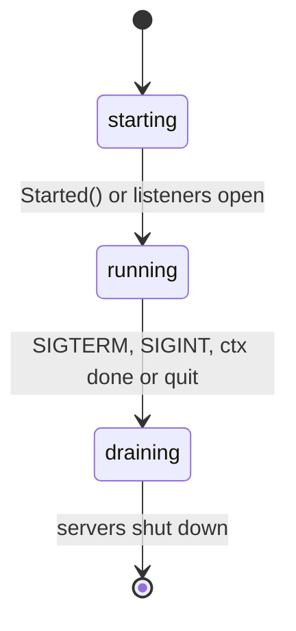

# System patterns

## 1. Current architecture

Code version `v0.0.4` (the `appVersion` constant) at commit `350fc44`,
which both consumers pin. `CLAUDE.md` at the repository root has the
details.

1. One `Handler` type with exported `Version`, `ServiceStatus`,
   `LogLevel`, `ShutdownChannel` and `Logger` fields, and an `Init`
   method.
2. Health and readiness each have three unexported flags and a mutex. The
   flags set the HTTP code; separate strings set the JSON body.
3. Consumers register every route themselves, with gorilla/mux.
4. logrus for logging and for runtime level and format changes.

`review-20261026.md` lists its defects. The design below replaces this
model instead of patching it.

## 2. Target architecture for v0.1.0

Status: proposed on 2026-10-26 and updated with the owner's answers the
same day; waiting for the owner's final read. Type and function names are
placeholders for planning.

### 2.1. Components

1. State: one guarded value with the lifecycle phase, the operator
   switches, the check results and the last heartbeat.
2. Checks: functions the application registers as optional or critical.
3. Probe handler: `/livez`, `/readyz`, `/startupz` and `/healthz`.
4. Admin handler: operator endpoints, on a listener of its own.
5. Lifecycle helper: `Run`, which starts the servers and runs the
   shutdown sequence.
6. Log level: a `slog.LevelVar` that the application passes to its slog
   handler.
7. Middleware: in-flight limiter and trace header propagation.
8. Metrics handler: `/metrics` in Prometheus text format.

### 2.2. State model

Inputs:

1. Lifecycle phase, set by the library and the application: `starting`,
   `running` or `draining`.
2. Operator switches, set only through the admin endpoints: `quiesced`
   and `failed`. Application code cannot change them.
3. Check results: each check is passing or failing. A check with no
   result yet counts as failing. An operator can force a check to pass or
   fail. The forced result is stored apart from the real one and wins
   until the operator clears it, so a background run cannot overwrite it.
4. Heartbeat: the time of the last beat, when the application uses it.



The reported state is the first match in this list:

1. `failed`: the `failed` switch is on, or the heartbeat is older than
   its timeout.
2. `draining`: the phase is `draining`.
3. `quiesced`: the `quiesced` switch is on.
4. `starting`: the phase is `starting`.
5. `unavailable`: at least one critical check is failing.
6. `degraded`: at least one optional check is failing.
7. `ready`: none of the above.

Probe results per state:

1. `failed`: `/livez` 503, `/readyz` 503.
2. `draining`, `quiesced`, `starting` and `unavailable`: `/livez` 200,
   `/readyz` 503.
3. `degraded`: `/livez` 200, `/readyz` 200 with body status `warn`.
4. `ready`: `/livez` 200, `/readyz` 200.
5. `/startupz` returns 503 while the phase is `starting` and 200 after.
6. `/healthz` is an alias of `/livez`.

Concurrency rules:

1. One mutex guards the state. Nothing is written to the network and
   nothing is marshalled while it is locked.
2. Probe handlers compute their result from a snapshot copy.
3. Bodies are marshalled from response types that contain no locks, and
   written with `w.Write` or a `json.Encoder`, never as a format string.

### 2.3. Dependency checks

1. Each check has a name, a kind (optional or critical), a function
   `func(context.Context) error`, an interval and a timeout.
2. Checks run in the background and cache their result. Probes read the
   cache and never run a check inline, so probe latency stays below the
   kubelet's default timeout of 1 second.
3. `Report(name, err)` lets the application push a result, for example
   after a failed call, without waiting for the next interval.
4. Check error text goes to the logs. Probe bodies leave it out unless an
   option turns it on.

### 2.4. Probe body

Field names follow the IETF health-check draft where they fit. `state`
and `kind` are fields of our own. Example for a degraded service:

```json
{
  "status": "warn",
  "state": "degraded",
  "version": "v0.1.0",
  "checks": {
    "cache": [{"status": "fail", "kind": "optional"}],
    "db": [{"status": "pass", "kind": "critical"}]
  }
}
```

A check whose result an operator forced has `"forced": true` in its
entry.

### 2.5. Admin endpoints

All under `/support/v1/`, the prefix the current consumers already use.
The library registers the routes itself. A wrong method returns 405. No
CORS headers are sent. Each change is logged at WARN level with the
caller's address.

1. `POST quiesce`: turns the `quiesced` switch on; readiness fails.
2. `POST resume`: turns the `quiesced` switch off.
3. `POST fail`: turns the `failed` switch on; liveness fails and the
   kubelet restarts the container after its failure threshold.
4. `POST recover`: turns the `failed` switch off.
5. `POST quit`: returns 202, then starts the shutdown sequence. The
   process exits with code 0.
6. `POST crash`: returns 202 and flushes the response, then exits with a
   non-zero code.
7. `GET version`: module, version and VCS revision from the Go build
   information.
8. `GET loglevel` and `PUT loglevel`: body `{"level":"DEBUG"}`. An
   unknown level returns 400.
9. `POST checks/{name}/fail`, `POST checks/{name}/pass` and
   `POST checks/{name}/clear`: force a check result, or go back to the
   real one. An unknown check name returns 404.
10. `POST overload` and `POST overload/clear`: make the in-flight limiter
    reject every request with 503, or stop doing so.

Removing CORS headers does not stop a web page in a presenter's browser
from sending a simple POST to a port-forwarded admin port. Action
endpoints therefore answer 403 to a request whose `Sec-Fetch-Site` is
`cross-site` or `same-site`, or whose `Origin` does not match the request
host. Tools such as `curl` send neither header.

Removed: `restart`, which did nothing, and `env`, which exposed secrets.

### 2.6. Lifecycle

`Run(ctx, servers...)`:

1. Opens a listener for each server and starts accepting requests.
2. Moves the phase to `running` once all listeners are open, unless the
   application already called `Started()` or waits to call it after its
   own warm-up.
3. Starts the background checks.
4. Waits for SIGTERM, SIGINT, the end of `ctx`, `quit`, or a server error.
   A server error, such as a port in use, is returned at once.
5. Moves the phase to `draining`. Readiness fails, liveness passes and the
   servers keep answering.
6. Waits `DrainDelay`, 5 seconds by default.
7. Shuts every server down with `ShutdownTimeout`, 20 seconds by default.
8. Returns nil after a clean shutdown, or the first error.

For crash loop demonstrations, `Run` reads the environment variable
`ZPAGES_CRASH_ON_START`. When it is set to a duration such as `5s`, `Run`
exits with code 1 that long after every start, so the pod ends in
`CrashLoopBackOff`. The prefix follows the naming decision.

`DrainDelay` plus `ShutdownTimeout` must stay below the pod's
`terminationGracePeriodSeconds`, 30 seconds by default. `DrainDelay`
should cover the readiness probe period times its failure threshold, and
the check interval of any external load balancer.

### 2.7. Middleware and metrics

1. `z.LimitInFlight(n, next)`: above `n` requests in progress, or while
   the admin `overload` switch is on, answers 503 with `Retry-After: 1`.
   It is a method so the switch can reach it. Mesh outlier detection
   counts these 503s and can eject the pod, which is worth showing in a
   demo. The limiter wraps only the application's own handler. Probe,
   admin and metrics handlers stay outside it, so overload never fails a
   probe.
2. `PropagateTrace(next)`: stores the trace headers of the inbound request
   in its context. `Transport(base)` copies them onto outbound requests
   made with that context. The header list must be checked against the
   Istio documentation.
3. `/metrics`, written by hand in Prometheus text format. Proposed series,
   with a prefix that depends on the naming decision:
   1. `zpages_state{state="..."}`: 1 for the current state, 0 for others.
   2. `zpages_check_up{check="...",kind="..."}`: 1 or 0.
   3. `zpages_inflight_requests` and `zpages_rejected_requests_total`.
   4. `zpages_build_info{version="...",revision="..."}`: always 1.
   5. `zpages_forced{target="..."}`: 1 for each forced check and for
      forced overload.

## 3. Key decisions

1. `adr/adr-20261026-01-standard-library-only.md`
2. `adr/adr-20261026-02-state-model-and-probes.md`
3. `adr/adr-20261026-03-admin-endpoints-and-lifecycle.md`
